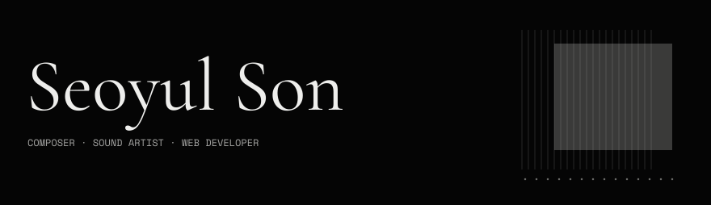

Beginning with music-making, the practice has long been concerned with how things pushed beyond the boundaries of normal and abnormal, center and outside, continue to remain. Extending this inquiry across media, it considers how they persist in distorted forms without being completely erased.

**[obf.kr](https://obf.kr)** · Community platform · 2026 
Next.js · React · TypeScript · Three.js

**[modularhabit.com](https://modularhabit.com)** · Festival website · 2026 
Next.js · React · TypeScript

**[AFTERNODE](https://afternode.co)** · Studio website · 2026 
Next.js 16 · React 19 · Tailwind CSS v4

**[IO](https://io.seoyulson.com/game)** · Interactive sound installation · 2026 
PixiJS · TypeScript · MediaPipe · Howler.js

**Lexicon** · Reading and knowledge tool · 2026 · Private · in use 
Next.js 16 · React 19 · Supabase

**[Dissolved Sound Archive](https://dissolvedsound.com)** · Exhibition archive · 2026 
React 19 · Vite · TypeScript

**UNFIXED** · Concert identity · 3D · print · 2026 
**DYSTOPIA · Dissolved Sound** · Exhibition identity · 2026 
**Obf : MODULAR HABIT 2026** · Festival identity · 3D · motion · 2026 
**Obf : SYNC** · Concert poster · 2026 
**STUDIO HENGE** · Motion identity · 2025–2026 
**E:STHER MUSIC ACADEMY** · Brand identity · web · 2026

More at **[seoyulson.com](https://seoyulson.com)**.
